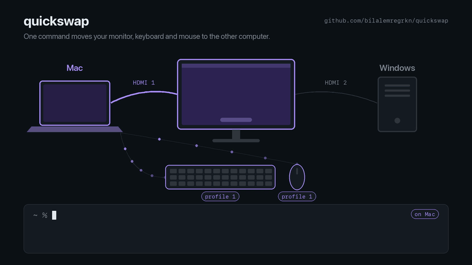

# quickswap

One command to move your desk from one computer to the other: it switches the **monitor input** and the **Logitech Easy-Switch channel** of your Bluetooth keyboard and mouse, together, from either a Mac or a Windows PC.



No KVM switch, no USB receiver, no vendor app. The monitor is driven over DDC/CI, the same channel the monitor's own menu uses, and the keyboard and mouse get the same HID++ command their Easy-Switch button sends.

## Requirements

| | |
|---|---|
| **macOS** | Apple Silicon. Monitor control goes through [`m1ddc`](https://github.com/waydabber/m1ddc), which doesn't support Intel Macs. |
| **Windows** | Windows 10/11. Uses the built-in Monitor Configuration API (`dxva2.dll`), nothing to install. |
| **Python** | 3.11+ |
| **Monitor** | DDC/CI support. On many monitors it has to be turned on in the on-screen menu. |
| **Keyboard / mouse** | Logitech devices with Easy-Switch, connected **directly over Bluetooth**. Devices behind a Unifying/Bolt USB receiver aren't supported. |

You can use only half of it: leave out the monitor and it just switches the devices, or list no devices and it just switches the monitor.

## Install

Do this on **each** computer.

**macOS**

```sh
brew install m1ddc pipx
pipx install git+https://github.com/bilalemregrkn/quickswap
```

**Windows** (PowerShell)

```powershell
winget install Python.Python.3.12      # skip if you already have Python 3.11+
py -m pip install --user pipx
py -m pipx ensurepath                   # then open a NEW terminal
pipx install git+https://github.com/bilalemregrkn/quickswap
```

`uv tool install git+https://github.com/bilalemregrkn/quickswap` works too.

## Set up


1. **Pair the devices.** Give each computer its own Easy-Switch channel on every device, and keep the numbering the same on all of them, e.g. channel 1 = Mac, channel 2 = Windows. To pair a channel, select it, hold its button for about 3 seconds until the light blinks fast, then add the device in the computer's Bluetooth settings.
2. **See what quickswap finds:**
   ```console
   $ quickswap discover
   monitors (use part of the name or id as [monitor] match):
     [ ] MSI G242  XXXXXXXX-XXXX-XXXX-XXXX-XXXXXXXXXXXX
   logitech bluetooth devices (use pid in [[logitech]]):
     pid = 0xB031  LIFT VERTICAL ERGONOMIC MOUSE  (3 profiles, now on 1)
     pid = 0xB38F  POP Icon Keys  (3 profiles, now on 1)
   ```
3. **Write a config.** This creates one pre-filled with what `discover` found:
   ```sh
   quickswap init
   ```
   Open the file (`quickswap config` prints its path) and check the values:
   - `input`: which monitor port each computer is plugged into (17 = HDMI 1, 18 = HDMI 2, 15 = DisplayPort 1, ...).
   - `profile`: which Easy-Switch channel each computer is paired on.
   - `default`: where a bare `quickswap` goes. `init` sets it to the *other* computer.

   See [`config.example.toml`](config.example.toml) for a full example.
4. **Check it:** `quickswap status` shows what will receive commands. The monitor you mean should have an `[x]`.
5. **Try it:** `quickswap <the other computer>`.

## Usage

```
quickswap [TARGET]        switch to TARGET (default: `default` from the config)
quickswap status          read-only: configured monitor and devices as seen from here
quickswap discover        read-only: every monitor and Logitech Bluetooth device, with ids for the config
quickswap init [--force]  write a starter config, pre-filled with what discover finds
quickswap config          print the config file path
```

The config lives at `~/.config/quickswap/config.toml` (macOS) or `%APPDATA%\quickswap\config.toml` (Windows). Set `QUICKSWAP_CONFIG` to use a different file.

## Things to know

- **Run it on the computer you're leaving.** A Bluetooth device only listens to the computer it's currently connected to. Your Mac can send the keyboard to Windows, but it can't pull it back. Once you've switched, you're typing on the other computer anyway, so run `quickswap` there to come back. Devices that aren't connected here are skipped with a note.
- **There's no toggle.** Many monitors don't report their current input reliably over DDC. The tested one always answers `110`. So you always name the target, or rely on `default`.
- **A MacBook in clamshell mode can lose the monitor.** With the lid closed, switching the monitor away leaves the Mac with no display, and it may go to sleep. Bring it back from the other computer.
- **A computer may not see the monitor while it shows the other one.** Some monitors (or OSes) treat an inactive input as disconnected, so that computer can't switch the monitor back to itself. With the tested MSI, a Mac with its lid open still sees it and can pull it back; Windows hasn't been checked. The normal flow avoids it anyway: you run `quickswap` on the computer that's on screen.

## Tested with

| | |
|---|---|
| Computers | MacBook Pro (M4 Max), Windows 11 25H2 |
| Monitor | MSI G242, both computers on HDMI |
| Devices | Logitech POP Icon Keys, Logitech LIFT Vertical Ergonomic Mouse |

Other monitors and Logitech devices with DDC/CI and HID++ `CHANGE_HOST` (`0x1814`) should work too. Please open an issue with what you tried, whether it worked or not.

## How it works

See [docs/how-it-works.md](docs/how-it-works.md) for the DDC and HID++ details, and for the gotchas found along the way.

## Using an AI coding agent

This repo includes an [AGENTS.md](AGENTS.md) (and a `CLAUDE.md` pointing to it). Open the repo in an agent such as Claude Code, Codex or Cursor and ask it to "set up quickswap on this machine". It'll go through discovery and config, ask you to confirm what changed on your desk, and warn you before anything disconnects.

The guide also covers hardware the code doesn't handle yet, such as non-standard monitor input values, devices on a USB receiver, or other OSes, so an agent can work it out on your hardware and extend the code.

## License

[MIT](LICENSE)
